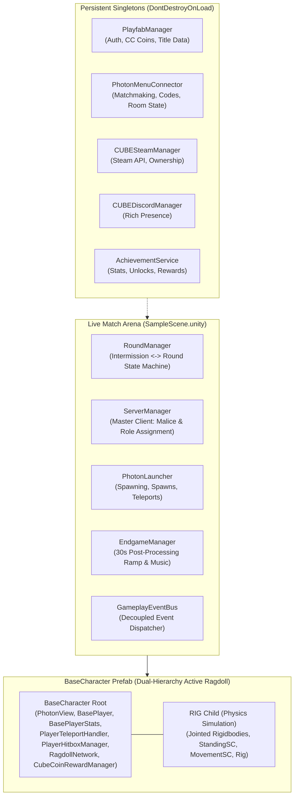

# AGENTS.md — AI Agent Briefing & Developer Guide for CUBE

Welcome to the **CUBE** codebase. This document is the primary onboarding guide for AI coding assistants (Antigravity, Cursor, Claude Code, Copilot) and human developers. It summarizes the architecture, core rules, conventions, and implementation recipes so you can immediately understand and modify the project without having to inspect dozens of individual source files.

---

## 1. Executive Summary & Tech Stack

**CUBE** is an asymmetric multiplayer physics-ragdoll party/survival game developed by NanoDogs Studios (`LaymGlitched`). Players spawn as physics-driven cubes in closed arenas; one player is selected as the **Killer** based on an adaptive karma system (**Malice**), while the others are **Survivors** tasked with outrunning and outlasting the Killer across timed rounds.

| Attribute | Details |
| :--- | :--- |
| **Project Name** | `CUBE` (Product GUID: `f38584c861618c048935b89971a66aaa`) |
| **Engine Version** | **Unity 7000.0.0a10** (Unity 6 / 6000 Preview) |
| **Render Pipeline** | Universal Render Pipeline (**URP 17.7.0**) |
| **Networking** | **Photon Unity Networking 2 (PUN 2)** + **Photon Voice** |
| **Backend & Auth** | **PlayFab SDK** (Device ID Auth, Title Data, Inventory, Virtual Currency `CC`) |
| **Platform SDKs** | **Steamworks.NET** (`com.rlabrecque.steamworks.net`), **Discord Partner SDK** |
| **Input System** | **New Unity Input System** (`com.unity.inputsystem` 6.7.0) |
| **Physics Style** | **Active Ragdoll Physics** (`Assets/Plugins/PhysicsChar`) + **MagicaCloth2** |
| **Build Scenes** | 1. `Assets/Scenes/Menu.unity` (Index 0)<br/>2. `Assets/Scenes/SampleScene.unity` (Index 1) |

---

## 2. Non-Negotiable Rules & Invariants for AI Agents

> [!CAUTION]
> ### RULE 1: NEVER RUN `dotnet build` OR TRIGGER UNITY BUILDS
> Do not propose, generate, or execute `dotnet build`, `csc`, or command-line Unity batch builds unless explicitly instructed by the user.
> 
> **To check compilation or drive the running Editor:** Always use the **Unity CLI / MCP Bridge** (`unity recompile`, `unity cmd console_status`, `unity cmd eval_file`). See [Section 8: Unity CLI & MCP Bridge Guide](#8-unity-cli--mcp-bridge-guide-for-ai-agents).

> [!CAUTION]
> ### RULE 2: NEVER SET `transform.position` DIRECTLY ON PLAYERS
> Characters are active ragdolls made of jointed rigidbodies. Directly setting `transform.position` causes joint stretching, physics explosions, and network desync. **Always** use:
> ```csharp
> player.GetComponent<PlayerTeleportHandler>().Teleport(targetPosition, targetRotation, snapToGround: true);
> ```

> [!IMPORTANT]
> ### RULE 3: MASTER CLIENT AUTHORITY BOUNDARIES
> Only the **Master Client** (`PhotonNetwork.IsMasterClient`) may:
> - Start or end rounds ([RoundManager.cs](file:///g:/Projects/physicsgamee/Assets/Scripts/RoundManager.cs)).
> - Calculate Malice, select the Killer, and assign roles ([ServerManager.cs](file:///g:/Projects/physicsgamee/Assets/Scripts/ServerManager.cs)).
> - Purge stale buffered RPCs.
> 
> The **Owning Client** (`photonView.IsMine`) controls local player input, camera look, active ragdoll physics, and claims local rewards.

> [!IMPORTANT]
> ### RULE 4: CLEAN UP BUFFERED RPCS ON ROUND TRANSITIONS
> Buffered RPCs (`RpcTarget.AllBuffered`) persist forever in Photon's room buffer unless cleared. When transitioning between rounds and intermission, stale buffered calls (`ApplyRoleAndCharacter`, `ApplyCharacterStats`, `StartRound`) **must** be removed with `PhotonNetwork.RemoveBufferedRPCs(...)` or `PhotonNetwork.RemoveRPCs(pv)` so late joiners don't receive invalid roles.

> [!NOTE]
> ### RULE 5: SCRIPTABLEOBJECT RESOURCE PATH CONVENTIONS
> [CharacterDatabase.cs](file:///g:/Projects/physicsgamee/Assets/Scripts/CharacterDatabase.cs) dynamically resolves characters at runtime via `Resources.Load()`. New assets **must** match:
> - Killers: `Assets/Resources/ScriptableObjects/Killers/{Name}/{Name} Type.asset`
> - Survivors: `Assets/Resources/ScriptableObjects/Survivors/{Name}/{Name} Type.asset`

---

## 3. Core Architecture & Mental Model



---

## 4. Master Script Directory

### Match Lifecycle & Server Logic
| Class | File Link | Description |
| :--- | :--- | :--- |
| **`RoundManager`** | [RoundManager.cs](file:///g:/Projects/physicsgamee/Assets/Scripts/RoundManager.cs) | Central round clock, intermission timer (~50s), round timer (180s), RPC state sync to late joiners. |
| **`ServerManager`** | [ServerManager.cs](file:///g:/Projects/physicsgamee/Assets/Scripts/ServerManager.cs) | Master Client role assignment; selects Killer by highest Malice; issues role & stat RPCs. |
| **`PhotonLauncher`** | [PhotonLauncher.cs](file:///g:/Projects/physicsgamee/Assets/Scripts/PhotonLauncher.cs) | Instantiates `BaseCharacter` prefab, populates map spawn points (`killerSpawns`, `survivorSpawns`). |
| **`EndgameManager`** | [EndgameManager.cs](file:///g:/Projects/physicsgamee/Assets/Scripts/EndgameManager.cs) | Triggers post-processing ramp (chromatic aberration, lens distortion, saturation) at 30 seconds. |
| **`ChaseHandler`** | [ChaseHandler.cs](file:///g:/Projects/physicsgamee/Assets/Scripts/ChaseHandler.cs) | Measures distance between Killer and Survivors; triggers chase music and state flags. |

### Player, Physics & Combat
| Class | File Link | Description |
| :--- | :--- | :--- |
| **`BasePlayer`** | [BasePlayer.cs](file:///g:/Projects/physicsgamee/Assets/Scripts/BasePlayer.cs) | Manages player type (`Killer`, `Survivor`, `None`), equipped character references, and Photon custom properties. |
| **`BasePlayerStats`** | [BasePlayerStats.cs](file:///g:/Projects/physicsgamee/Assets/Scripts/BasePlayerStats.cs) | Health, max health, stamina, speed, malice, CC coins. Handles `TakeDamage` RPC and camera shake. |
| **`PlayerTeleportHandler`** | [PlayerTeleportHandler.cs](file:///g:/Projects/physicsgamee/Assets/Scripts/PlayerTeleportHandler.cs) | Safe 7-step coroutine for teleporting active ragdolls without breaking physics joints. |
| **`RagdollNetwork`** | [RagdollNetwork.cs](file:///g:/Projects/physicsgamee/Assets/Scripts/RagdollNetwork.cs) | PUN observable streaming hip transform + 15 bone local transforms with adaptive jitter interpolation. |
| **`PlayerPuncher`** | [PlayerPuncher.cs](file:///g:/Projects/physicsgamee/Assets/Scripts/PlayerPuncher.cs) | Killer melee punch via `Physics.OverlapBox` in front of camera against `Player` layer. |
| **`PlayerHitboxManager`** | [PlayerHitboxManager.cs](file:///g:/Projects/physicsgamee/Assets/Scripts/PlayerHitboxManager.cs) | Discovers bone `CollisionCallback` colliders; routes incoming hits to `RPC_OnHit`. |
| **`DeathSC`** | [DeathSC.cs](file:///g:/Projects/physicsgamee/Assets/Scripts/DeathSC.cs) | Collapses ragdoll joints (`rig.control = 0`), starts 5s respawn, transitions to spectator mode mid-round. |
| **`SprintingSC`** | [SprintingSC.cs](file:///g:/Projects/physicsgamee/Assets/Scripts/SprintingSC.cs) | Multiplies movement force and drains stamina while sprint key is held. |
| **`CrouchingSC`** | [CrouchingSC.cs](file:///g:/Projects/physicsgamee/Assets/Scripts/CrouchingSC.cs) | Compresses ragdoll standing height and applies speed penalty while Left Control is held. |
| **`PlayerCustomizer`** | [PlayerCustomizer.cs](file:///g:/Projects/physicsgamee/Assets/Scripts/PlayerCustomizer.cs) | Applies character textures during rounds, and user-selected custom hex colors during intermission. |

### Abilities & Characters
| Class | File Link | Description |
| :--- | :--- | :--- |
| **`CubePlayerBase`** | [CubePlayerBase.cs](file:///g:/Projects/physicsgamee/Assets/Scripts/CubePlayerBase.cs) | Base ScriptableObject defining stats (`Health`, `Speed`, `Stamina`), cost, difficulty, and abilities. |
| **`KillerType`** | [KillerType.cs](file:///g:/Projects/physicsgamee/Assets/Scripts/KillerType.cs) | Inherits `CubePlayerBase`. Adds `TerrorRadius`, `PunchDamage`, and `punchHitboxSize`. |
| **`SurvivorType`** | [SurvivorType.cs](file:///g:/Projects/physicsgamee/Assets/Scripts/SurvivorType.cs) | Inherits `CubePlayerBase` for survivor classes. |
| **`Ability`** | [Ability.cs](file:///g:/Projects/physicsgamee/Assets/Scripts/Ability.cs) | Base ScriptableObject for active and passive abilities; binds to Input System actions. |
| **`PlayerAbilityManager`** | [PlayerAbilityManager.cs](file:///g:/Projects/physicsgamee/Assets/Scripts/PlayerAbilityManager.cs) | Instantiates ability HUD slots, tracks cooldown timers, listens for input, and executes abilities. |
| **`CharacterDatabase`** | [CharacterDatabase.cs](file:///g:/Projects/physicsgamee/Assets/Scripts/CharacterDatabase.cs) | Static helper loading character assets from `Resources/ScriptableObjects/...`. |

### Cloud, Economy & Achievements
| Class | File Link | Description |
| :--- | :--- | :--- |
| **`PlayfabManager`** | [PlayfabManager.cs](file:///g:/Projects/physicsgamee/Assets/Scripts/PlayfabManager.cs) | Silent device login, virtual currency (`CC`), title data / MOTD announcements. |
| **`CubeCoinRewardManager`** | [CubeCoinRewardManager.cs](file:///g:/Projects/physicsgamee/Assets/Scripts/CubeCoinRewardManager.cs) | Tracks round actions (distance, ability uses, kills, wins) and grants CC with abuse caps. |
| **`ShopManager`** | [ShopManager.cs](file:///g:/Projects/physicsgamee/Assets/Scripts/ShopManager.cs) | In-game store tabs (Killers, Survivors, Emotes); verifies purchases via PlayFab API. |
| **`GameplayEventBus`** | [GameplayEventBus.cs](file:///g:/Projects/physicsgamee/Assets/Scripts/Achievements/Events/GameplayEventBus.cs) | Global event dispatcher publishing gameplay occurrences to statistics and achievement services. |
| **`AchievementService`** | [AchievementService.cs](file:///g:/Projects/physicsgamee/Assets/Scripts/Achievements/Core/AchievementService.cs) | Evaluates achievement criteria; forwards unlocks to Steamworks and PlayFab platform adapters. |

---

## 5. Playable Roster & Movesets

### Killers
1. **The Glitch**: High mobility anomaly.
   - `GlitchDash`: Instant forward teleport burst.
   - `GlitchShard`: Fires a crystalline projectile causing damage and vision glitches.
2. **The Titan**: Heavy tank juggernaut.
   - `Shockwave`: Radial ground slam knocking back all nearby survivors.
   - `WindSwipe`: Forward sweeping pressure wave that staggers fleeing survivors.

### Survivors
1. **The Coder**: Evasive utility survivor.
   - `CompileBoost`: Speed burst to break away from chases.
   - `LagSpike`: AoE trap slowing anyone entering the radius.
   - `OverclockedMind`: Passive ticking cooldowns 10% faster outside of chases.
2. **The DJ**: Team buffer & defensive crowd control.
   - `Equalizer`: Force barrier pushing attackers backward.
   - `MusicCircle`: Ground aura providing buffs to teammates.
   - `Hype`: Speed and stamina regeneration boost.
3. **The Healer**: Support & sustain medic.
   - `HealCircle`: Restorative zone healing all survivors within.
   - `HealProximity`: Directed healing beam toward the nearest wounded survivor.
   - `LastStand`: Clutch passive granting damage resistance when health is critical.

---

## 6. Developer Recipes & Common Workflows

### Recipe A: Teleporting a Player Safely
```csharp
// Get the teleport handler from the local player instance
PlayerTeleportHandler teleporter = PhotonLauncher.LocalPlayerInstance.GetComponent<PlayerTeleportHandler>();
if (teleporter != null)
{
    // Teleports all rigidbodies, syncs physics, and snaps to ground
    teleporter.Teleport(new Vector3(10f, 0f, 5f), Quaternion.identity, snapToGround: true);
}
```

### Recipe B: Dealing Networked Damage
```csharp
// On the attacking client (e.g., Killer punching or casting projectile)
PhotonView targetPV = targetPlayer.GetComponent<PhotonView>();
if (targetPV != null && !targetPV.IsMine)
{
    int damage = 20;
    targetPV.RPC(nameof(PlayerHitboxManager.RPC_OnHit), RpcTarget.All, damage);
}
```

### Recipe C: Adding a New Character
1. Create asset via Right-Click: `Create/ScriptableObjects/Killer Type` (or `Survivor Type`).
2. Populate `_Name`, `Health`, `Speed`, `Stamina`, `abilities[]`, and `Cost`.
3. Save to exact folder:
   - Killer: `Assets/Resources/ScriptableObjects/Killers/{Name}/{Name} Type.asset`
   - Survivor: `Assets/Resources/ScriptableObjects/Survivors/{Name}/{Name} Type.asset`
4. Register the item ID in PlayFab's `shop` catalog if purchasable with CC.

### Recipe D: Adding a New Active Ability
1. Create a script inheriting from `Ability`:
   ```csharp
   [CreateAssetMenu(fileName = "NewAbility", menuName = "ScriptableObjects/Abilities/New Ability")]
   public class NewAbility : Ability
   {
       public override void ActivateAbility(BasePlayer player)
       {
           base.ActivateAbility(player);
           // Implement gameplay logic here (spawn prefab, apply buff, etc.)
       }
   }
   ```
2. Create the ScriptableObject asset, configure `AbilityCooldown`, icon, and input action name (`"Ability1"` or `"Ability2"`).
3. Assign the asset into the character's `abilities` array.

### Recipe E: Firing an Achievement / Statistics Event
```csharp
// Fire anywhere in gameplay code without coupling to achievement managers
CUBE.Achievements.GameplayEventBus.RaiseEvent(new CUBE.Achievements.GameplayEvent
{
    EventType = CUBE.Achievements.GameplayEventType.KillerEliminatedSurvivor,
    Actor = attackerGameObject,
    Target = victimGameObject,
    Timestamp = Time.time
});
```

---

## 7. Deep-Dive Documentation Index

For exhaustive technical breakdowns of individual subsystems, consult the modular documentation in the [`docs/`](file:///g:/Projects/physicsgamee/docs/) directory:

- [docs/ARCHITECTURE.md](file:///g:/Projects/physicsgamee/docs/ARCHITECTURE.md) — Scene structure, execution flow, singletons, and player prefab composition.
- [docs/NETWORKING.md](file:///g:/Projects/physicsgamee/docs/NETWORKING.md) — Photon PUN 2 topology, Master Client authority, RPC buffering rules, and `RagdollNetwork` streaming.
- [docs/PLAYER_PHYSICS_AND_COMBAT.md](file:///g:/Projects/physicsgamee/docs/PLAYER_PHYSICS_AND_COMBAT.md) — Active ragdoll mechanics, `PlayerTeleportHandler` pipeline, melee punch hitboxes, damage, death, and spectator mode.
- [docs/CHARACTERS_AND_ABILITIES.md](file:///g:/Projects/physicsgamee/docs/CHARACTERS_AND_ABILITIES.md) — Data schemas, `CharacterDatabase` dynamic resolution, full moveset details, and ability input binding.
- [docs/GAME_LOOP_AND_ECONOMY.md](file:///g:/Projects/physicsgamee/docs/GAME_LOOP_AND_ECONOMY.md) — Intermission/Round state machine, Malice killer algorithm, Cube Coin (`CC`) reward triggers, and PlayFab shop.
- [docs/ACHIEVEMENTS_AND_EVENTS.md](file:///g:/Projects/physicsgamee/docs/ACHIEVEMENTS_AND_EVENTS.md) — Decoupled `GameplayEventBus`, statistics aggregation, requirement trees, and multi-platform adapters (Steam/PlayFab).

---

## 8. Unity CLI & MCP Bridge Guide for AI Agents

> [!TIP]
> **Use the live Unity CLI / MCP bridge instead of guessing or building from the command line.**
> When Unity Editor is open, a local automation bridge runs on port 7800. AI agents should use the installed Unity CLI binary to trigger recompilation, inspect live scene hierarchies, read console logs, and author GameObjects/components directly in scenes and prefabs.

### 8.1 Tool Location & Configuration
- **CLI Executable Path**: `C:\Users\Dylan\AppData\Local\Unity\bin\unity.exe`
- **MCP Config**: `C:\Users\Dylan\.gemini\config\mcp_config.json` (server name: `unity`, args: `["mcp"]`)
- **Connected Port**: `7800` (auto-detected when running commands from project root `G:\Projects\physicsgamee`).

### 8.2 Essential Commands Cheat Sheet

| Task | Command | Description |
| :--- | :--- | :--- |
| **Check Editor Status** | `unity status` | Verifies connected Editor PID, version (`7000.0.0a10`), active project path, and port. |
| **Recompile Scripts** | `unity recompile` | Requests the running Editor to recompile scripts. Returns exit code 0 on success or list of `CS` errors with line numbers. |
| **Ground-Truth Console** | `unity cmd console_status` | Returns compilation status (`compilationFailed: false`), console error count, and warnings without polling logs. |
| **Read Console Entries** | `unity cmd console --json` | Retrieves recent log entries, warnings, exceptions, and stack traces directly from Unity's internal buffer. |
| **Execute C# Script** | `unity cmd eval_file <path.cs>` | Compiles and executes an arbitrary C# script in the running Editor via Roslyn. Ideal for scene authoring. |
| **Evaluate One-Liner** | `unity cmd eval "return <code>;"` | Evaluates a single C# expression and returns the serialized JSON result. |
| **Save Scene** | `unity cmd save_scene` | Saves open scenes to persist changes made via `eval_file`. |

### 8.3 Recipe: Direct Scene Authoring (No Runtime Procedural Building)

**Rule**: Do not write monolithic C# scripts that procedurally instantiate UI hierarchies, add buttons, and style colors at runtime in `Start()`. Instead, use `unity cmd eval_file` to author GameObjects and wire components directly into the scene or prefab asset.

1. **Write an Editor Script into Scratch**:
   Save a `.cs` file to your conversation scratch folder (`<appDataDir>/brain/<conversationId>/scratch/setup_ui.cs`):
   ```csharp
   // scratch/setup_ui.cs
   var scene = UnityEngine.SceneManagement.SceneManager.GetActiveScene();
   var root = UnityEngine.GameObject.Find("Pause/Paused");

   // Modify existing buttons
   var btnTransform = root.transform.Find("List/Players");
   var btn = btnTransform.GetComponent<UnityEngine.UI.Button>();
   var targetComponent = root.GetComponentInParent<PauseMenu>();

   // Add persistent onClick listener via UnityEventTools
   while (btn.onClick.GetPersistentEventCount() > 0)
       UnityEditor.Events.UnityEventTools.RemovePersistentListener(btn.onClick, 0);

   var action = System.Delegate.CreateDelegate(
       typeof(UnityEngine.Events.UnityAction),
       targetComponent,
       "OpenPlayersModal"
   ) as UnityEngine.Events.UnityAction;

   UnityEditor.Events.UnityEventTools.AddPersistentListener(btn.onClick, action);
   UnityEditor.EditorUtility.SetDirty(btn);

   // Mark scene dirty and save
   UnityEditor.SceneManagement.EditorSceneManager.MarkSceneDirty(scene);
   UnityEditor.SceneManagement.EditorSceneManager.SaveScene(scene);
   return "UI authored and saved successfully!";
   ```

2. **Run it via CLI**:
   ```powershell
   & "C:\Users\Dylan\AppData\Local\Unity\bin\unity.exe" cmd eval_file "C:\Users\Dylan\...path...\scratch\setup_ui.cs"
   ```

3. **Verify via Console Status**:
   ```powershell
   & "C:\Users\Dylan\AppData\Local\Unity\bin\unity.exe" cmd console_status
   ```

