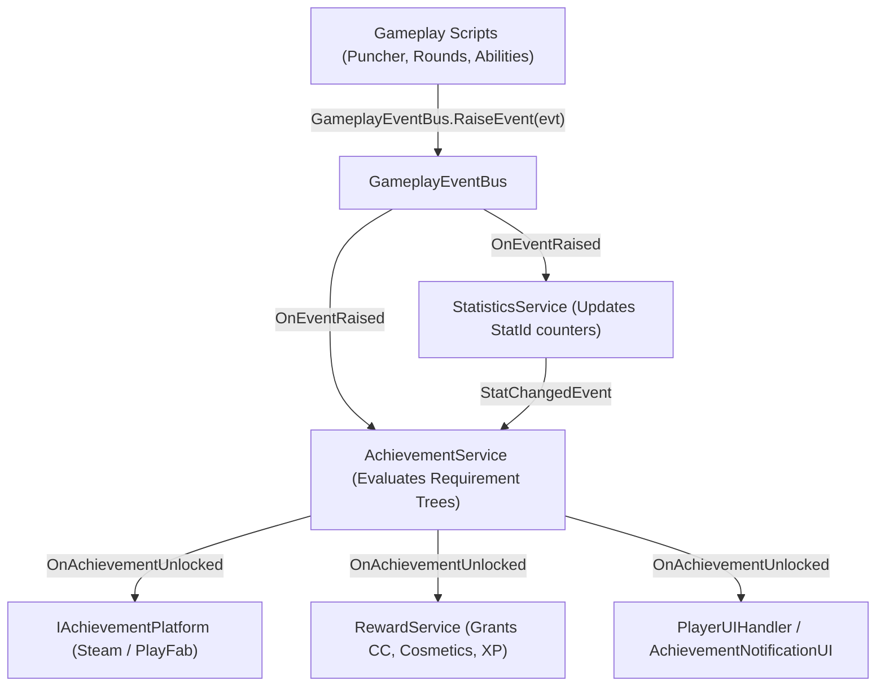

# Achievements, Statistics & Event Bus System

This document outlines the architecture of the **Achievements and Statistics Subsystem** located in `Assets/Scripts/Achievements`. The system is built on a decoupled, event-driven pattern designed for cross-platform extensibility (Steam, PlayFab, Epic, Console).

---

## 1. System Architecture & Component Interaction



---

## 2. Decoupled Event Bus ([GameplayEventBus.cs](file:///g:/Projects/physicsgamee/Assets/Scripts/Achievements/Events/GameplayEventBus.cs))

The game uses a global, static event bus to eliminate tight coupling between gameplay logic and achievement tracking.

### Raising an Event
```csharp
GameplayEventBus.RaiseEvent(new GameplayEvent
{
    EventType = GameplayEventType.KillerEliminatedSurvivor,
    Actor = localPlayerInstance,
    Target = targetVictimInstance,
    Timestamp = Time.time
});
```

### Common `GameplayEventType` Definitions:
- `RoundStarted`, `RoundEnded`
- `SurvivorEscaped`, `KillerEliminatedSurvivor`
- `AbilityUsed`, `DamageDealt`, `DamageTaken`
- `DistanceTraveled`, `ItemPurchased`, `EmoteUsed`

---

## 3. Statistics Engine ([StatisticsService.cs](file:///g:/Projects/physicsgamee/Assets/Scripts/Achievements/Statistics/StatisticsService.cs))

Tracks incremental counters across two distinct scopes defined in [StatScope.cs](file:///g:/Projects/physicsgamee/Assets/Scripts/Achievements/Statistics/StatScope.cs):
1. **Lifetime**: Persisted permanently across all play sessions (e.g., total kills, total distance traveled, total CC earned).
2. **Round**: Reset to zero at the start of every active round (e.g., kills in a single round, abilities used without taking damage).

When a statistic changes, `StatisticsService` dispatches a `StatChangedEvent`, allowing reactive achievements to evaluate immediately.

---

## 4. Achievement Definitions & Requirement Engine

Achievements are defined as ScriptableObjects of type [AchievementDefinition.cs](file:///g:/Projects/physicsgamee/Assets/Scripts/Achievements/Core/AchievementDefinition.cs) and registered within [AchievementDatabase.cs](file:///g:/Projects/physicsgamee/Assets/Scripts/Achievements/Core/AchievementDatabase.cs) (`Assets/Resources/CUBE Achievements.asset`).

### Modular Requirement Components:
- **`StatRequirement`**: Checks if a statistic exceeds or equals a target threshold (e.g., `TotalKills >= 50`).
- **`CharacterRequirement`**: Enforces that the player is playing a specific character (e.g., `The Glitch`).
- **`RoleRequirement`**: Enforces that the player is currently a `Killer` or `Survivor`.
- **`EventPropertyRequirement`**: Validates specific payload data attached to a `GameplayEvent`.
- **`RequirementGroupAsset`**: Combines multiple requirements using logical AND/OR conditions.

---

## 5. Multi-Platform Abstraction ([IAchievementPlatform.cs](file:///g:/Projects/physicsgamee/Assets/Scripts/Achievements/Platform/IAchievementPlatform.cs))

When an achievement unlocks, `AchievementService` automatically forwards the unlock to all registered platform adapters:

| Platform Adapter | Implementation Script | Target Service |
| :--- | :--- | :--- |
| **Steam** | [SteamAchievementPlatform.cs](file:///g:/Projects/physicsgamee/Assets/Scripts/Achievements/Platform/SteamAchievementPlatform.cs) | `Steamworks.SteamUserStats.SetAchievement` |
| **PlayFab** | [PlayFabAchievementPlatform.cs](file:///g:/Projects/physicsgamee/Assets/Scripts/Achievements/Platform/PlayFabAchievementPlatform.cs) | PlayFab Player Data / Statistics Sync |
| **Epic / Console** | `EpicAchievementPlatform.cs`, `XboxAchievementPlatform.cs`, etc. | Ready for console/EGS platform integrations |

---

## 6. Rewards Pipeline ([RewardService.cs](file:///g:/Projects/physicsgamee/Assets/Scripts/Achievements/Rewards/RewardService.cs))

Achievements can grant immediate rewards upon unlock:
- **`CubeCoinsReward`**: Grants CC directly into the player's PlayFab wallet.
- **`CosmeticReward`**: Unlocks exclusive skins, titles, or accessories.
- **`XpReward`**: Grants progression experience points.

---

## 7. Guide: Adding a New Achievement

1. **Create the Asset**:
   - Right Click in `Assets/Settings/Achievements/<Category>/` -> `Create/CUBE/Achievement Definition`.
   - Set Title, Description, Category, and Icon.
2. **Add Requirements**:
   - Add a `StatRequirement` (e.g., `StatId.TotalSurvivorsEliminated >= 10`).
   - (Optional) Add a `RoleRequirement` (`BasePlayer.PlayerType.Killer`).
3. **Add Rewards (Optional)**:
   - Add a `CubeCoinsReward` (e.g., 250 CC).
4. **Register in Database**:
   - Open `Assets/Resources/CUBE Achievements.asset`.
   - Add the new achievement to the list, or use the editor helper auto-populator.
