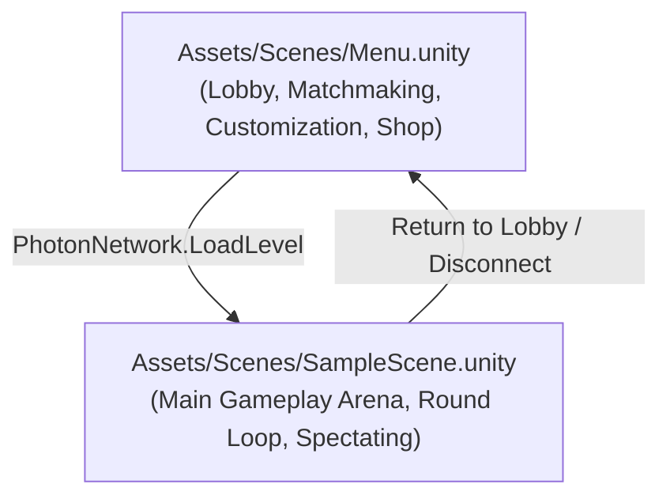

# System Architecture & Technical Overview

This document provides a high-level technical blueprint of **CUBE**, detailing its engine setup, scene composition, singleton managers, entity hierarchies, and data architecture.

---

## 1. Engine & Technical Stack

| Component | Technology | Version / Reference |
| :--- | :--- | :--- |
| **Engine** | Unity | `7000.0.0a10` (Unity 6 / 6000 Preview) |
| **Render Pipeline** | Universal Render Pipeline (URP) | `17.7.0` |
| **Multiplayer / Networking** | Photon Unity Networking 2 (PUN 2) + Photon Voice | Custom integration (`Assets/Photon`) |
| **Backend & Cloud** | PlayFab SDK (Auth, Currency `CC`, Inventory, Title Data) | `PlayFabClientAPI` (`Assets/PlayFabSDK`) |
| **Platform Services** | Steamworks.NET (Steam API, Auth, Achievements) | `com.rlabrecque.steamworks.net` |
| **Social / Rich Presence** | Discord Partner SDK + DiscordRPC | `com.discord.partnersdk`, `Assets/DiscordRPC` |
| **Input System** | Unity Input System (New) | `com.unity.inputsystem` (`6.7.0`) |
| **Physics / Characters** | PhysicsChar Active Ragdoll Physics | `Assets/Plugins/PhysicsChar` |
| **Deformation / Secondary Physics** | MagicaCloth2 | `Assets/MagicaCloth2` |
| **Camera Shake** | EZ Camera Shake | `Assets/EZ Camera Shake` |
| **UI Components** | TextMeshPro, HSV Color Picker, UI Rounded Corners | `Assets/TextMesh Pro`, `UiRoundedCorners` |

> [!IMPORTANT]
> **Build Rule**: Never execute `dotnet build` or trigger command-line Unity builds directly unless specifically instructed by the user.

---

## 2. Scene Architecture & Execution Flow

The project is structured around two primary build scenes defined in `ProjectSettings/EditorBuildSettings.asset`:



### 1. `Assets/Scenes/Menu.unity`
- **Purpose**: Main menu, PlayFab device authentication, public matchmaking, private game room creation/joining (via 5-character room codes), shop/customization browser, audio/graphics settings, and credits.
- **Key Scene Entities**:
  - `Canvas`: UI hierarchy containing Main Menu, Play Menu, Join Room popup, Shop modal, Settings modal, Profile/Name editor.
  - `PhotonMenuConnector`: Handles lobby connections, room creation, and room joining.
  - `MenuCameraController`: Cinematic camera panning over the menu scene.
  - `MenuCubeSpawner`: Spawns decorative physics cubes in the background.

### 2. `Assets/Scenes/SampleScene.unity`
- **Purpose**: The live gameplay arena. Houses the round state machine, map geometry, spawn points, player instantiation, camera post-processing, and HUD.
- **Key Scene Entities**:
  - `Multiplayer`: Master gameplay controller containing:
    - [RoundManager](file:///g:/Projects/physicsgamee/Assets/Scripts/RoundManager.cs): Timer, round/intermission state transitions, player role synchronization.
    - [ServerManager](file:///g:/Projects/physicsgamee/Assets/Scripts/ServerManager.cs): Master Client logic for malice tracking and killer/survivor role selection.
    - [PhotonLauncher](file:///g:/Projects/physicsgamee/Assets/Scripts/PhotonLauncher.cs): Player spawning, spawn point discovery, and map tracking.
    - [EndgameManager](file:///g:/Projects/physicsgamee/Assets/Scripts/EndgameManager.cs): 30-second warning visuals (chromatic aberration, lens distortion, music ramp).
    - [MusicManager](file:///g:/Projects/physicsgamee/Assets/Scripts/MusicManager.cs): Background OST management for round and intermission states.
  - `Global Volume`: URP Volume hosting Bloom, Tonemapping, Chromatic Aberration, Lens Distortion, and Color Adjustments.
  - `Canvas`: In-game HUD (`PlayerUIHandler`), stamina/health bars, ability slots (`PlayerAbilityManager`), malice counters, and spectator UI.

---

## 3. Persistent Singletons (Don't Destroy On Load)

Several core systems persist across scene transitions via `Object.DontDestroyOnLoad`:

| Singleton | Script Path | Primary Responsibility |
| :--- | :--- | :--- |
| **`PlayfabManager.Instance`** | [PlayfabManager.cs](file:///g:/Projects/physicsgamee/Assets/Scripts/PlayfabManager.cs) | Authenticates via device ID, manages Cube Coins (`CC`), syncs display names and title data. |
| **`PhotonMenuConnector.Instance`** | [PhotonMenuConnector.cs](file:///g:/Projects/physicsgamee/Assets/Scripts/PhotonMenuConnector.cs) | Connects to Photon master servers, creates/joins rooms, preserves connection across scene loads. |
| **`CUBESteamManager.Instance`** | [CUBESteamManager.cs](file:///g:/Projects/physicsgamee/Assets/Scripts/CUBESteamManager.cs) | Initializes Steamworks API, validates game ownership, wraps Steam callbacks. |
| **`CUBEDiscordManager`** | [CUBEDiscordManager.cs](file:///g:/Projects/physicsgamee/Assets/Scripts/CUBEDiscordManager.cs) | Publishes real-time Rich Presence to Discord (playing as Killer/Survivor, room code, party size). |
| **`AchievementService.Instance`** | [AchievementService.cs](file:///g:/Projects/physicsgamee/Assets/Scripts/Achievements/Core/AchievementService.cs) | Evaluates achievement criteria, tracks statistics, communicates with platform achievement APIs. |

---

## 4. Player Entity Structure (`BaseCharacter.prefab`)

Players are instantiated over the network via `PhotonNetwork.Instantiate("BaseCharacter", ...)`. The prefab employs a **dual-hierarchy architecture** separating the networked logic container from the simulated active ragdoll physics:

```
BaseCharacter (Network Root)
├── PhotonView (ViewID, Ownership)
├── Rigidbody (Kinematic, isKinematic=true, no gravity)
├── BasePlayer (Role: Killer/Survivor, equipped SO references)
├── BasePlayerStats (Health, stamina, speed, malice, CC)
├── PlayerTeleportHandler (Safe multi-rigidbody teleport pipeline)
├── PlayerCustomizer (Bone mesh recoloring, accessory attachment)
├── PlayerHitboxManager (Melee hit reception & collider discovery)
├── RagdollNetwork (Hip + 15 bone networked streaming & interpolation)
├── CubeCoinRewardManager (Tracks round actions, grants CC via PlayFab)
├── ChaseHandler (Tracks proximity between Killer and Survivors)
├── DeathSC (Ragdoll collapse, respawn coroutine, spectator trigger)
├── SpectatorController (Free-orbit camera cycling living players)
├── StatusEffectReceiver (Applies screen effects & cooldown mods)
├── RIG (Physics Character Child)
│   ├── Hip (Root ragdoll bone with primary Rigidbody)
│   ├── Spine / Chest / Head
│   ├── Arms & Legs (Jointed Rigidbodies & Colliders)
│   ├── StandingSC (Active upright balance & leg forces)
│   ├── MovementSC (Applies directional forces based on stats)
│   └── Rig (Active joint strength multiplier)
└── CameraHead
    └── Cam
        └── C (Main Camera with CameraInput, PlayerCameraReferences, AudioListener)
```

---

## 5. Data Flow & Communication Patterns

1. **Decoupled Gameplay Events**:
   - The achievement and stats subsystems communicate using [GameplayEventBus](file:///g:/Projects/physicsgamee/Assets/Scripts/Achievements/Events/GameplayEventBus.cs).
   - Scripts publish events (`GameplayEventBus.RaiseEvent(new GameplayEvent(...))`) without directly referencing achievement or stat managers.

2. **Network Remote Procedure Calls (RPCs)**:
   - High-impact state transitions (Round start, role assignment, damage, death) use `[PunRPC]` methods.
   - Master Client broadcasts authoritative outcomes via `photonView.RPC(..., RpcTarget.AllBuffered)`.
   - Damage and transient hit feedback use `RpcTarget.All`.

3. **Continuous Network Streaming**:
   - Continuous physical movement uses Photon streams via `IPunObservable` on [RagdollNetwork](file:///g:/Projects/physicsgamee/Assets/Scripts/RagdollNetwork.cs).
   - Remote instances run kinematic smoothing and Hermite spline interpolation against an adaptive jitter buffer.

4. **ScriptableObject Database**:
   - Characters and abilities are data-driven ScriptableObjects stored in `Assets/Resources/ScriptableObjects/`.
   - Loaded dynamically at runtime via [CharacterDatabase](file:///g:/Projects/physicsgamee/Assets/Scripts/CharacterDatabase.cs) using `Resources.Load()`.
