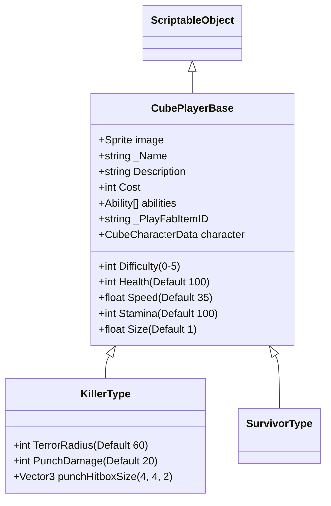
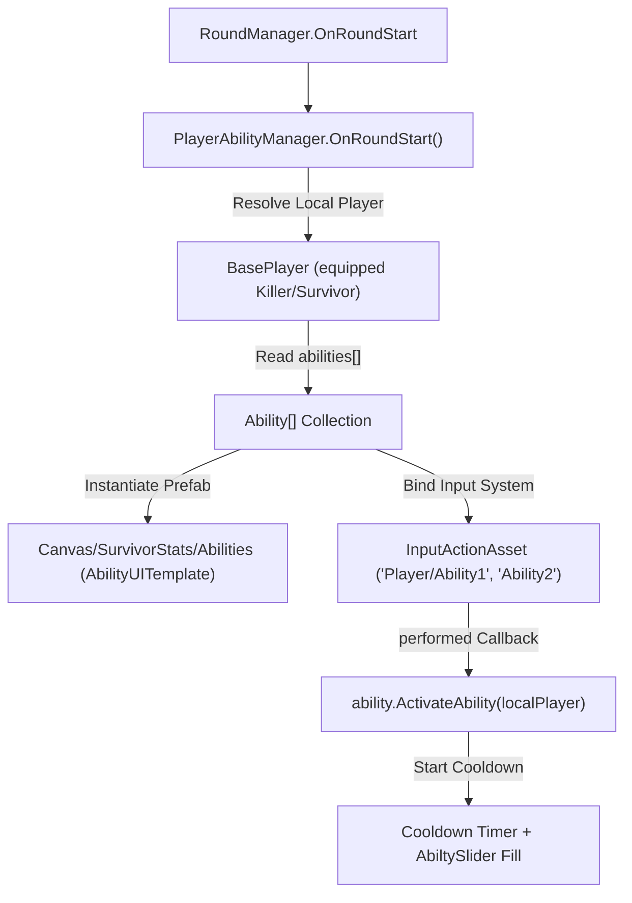

# Characters, Roster & Ability Architecture

This document details the character classification hierarchy, ScriptableObject data schemas, dynamic runtime loading via `CharacterDatabase`, the ability framework, and the current playable roster.

---

## 1. Class Hierarchy & ScriptableObject Schema

Every character in CUBE is defined as a data asset inheriting from [CubePlayerBase.cs](file:///g:/Projects/physicsgamee/Assets/Scripts/CubePlayerBase.cs):



---

## 2. Dynamic Asset Discovery ([CharacterDatabase.cs](file:///g:/Projects/physicsgamee/Assets/Scripts/CharacterDatabase.cs))

CUBE relies on structured `Resources.Load` conventions to resolve character definitions by name without needing hardcoded inspector lists:

| Type | Expected Asset Path | Method |
| :--- | :--- | :--- |
| **Killer** | `Assets/Resources/ScriptableObjects/Killers/{Name}/{Name} Type.asset` | `CharacterDatabase.GetKillerByName(name)` |
| **Survivor** | `Assets/Resources/ScriptableObjects/Survivors/{Name}/{Name} Type.asset` | `CharacterDatabase.GetSurvivorByName(name)` |

> [!IMPORTANT]
> When adding a new character, you **must** place the `.asset` file inside the exact path matching `{Name}/{Name} Type`. Any mismatch will cause `Resources.Load` to return `null` and default fallbacks to engage.

---

## 3. Playable Roster & Movesets

### Killers

#### 1. The Glitch
- **Description**: Erratic, unpredictable anomaly capable of tearing through space.
- **Base Stats**: Punch Damage = 20, Terror Radius = 60m.
- **Abilities**:
  - `GlitchDash` (Active, Slot 1): Warps forward instantly through space, bypassing geometry and closing gaps on fleeing survivors.
  - `GlitchShard` (Active, Slot 2): Launches a crystallized glitch projectile dealing direct damage and applying screen distortion on hit.

#### 2. The Titan
- **Description**: Enormous powerhouse exerting massive physical force over the arena.
- **Base Stats**: Punch Damage = 20, Terror Radius = 60m, Larger Hitbox.
- **Abilities**:
  - `Shockwave` (Active, Slot 1): Slams the ground, emitting a radial physical force that knocks back nearby survivors and disrupts their balance.
  - `WindSwipe` (Active, Slot 2): Sweeps a wide pressure wave forward, staggering any survivor caught in its path.

---

### Survivors

#### 1. The Coder
- **Description**: Technical survivor who manipulates match parameters to outsmart threats.
- **Base Stats**: Standard Health = 100, Speed = 35.
- **Abilities**:
  - `CompileBoost` (Active, Slot 1): Injects an emergency surge of speed into movement motors for a rapid escape.
  - `LagSpike` (Active, Slot 2): Deploys a localized temporal disturbance that severely slows down enemies entering its radius.
  - `OverclockedMind` (Passive): Ticks active ability cooldowns 10% faster while out of chase ([StatusEffectReceiver.cs](file:///g:/Projects/physicsgamee/Assets/Scripts/StatusEffectReceiver.cs)).

#### 2. The DJ
- **Description**: High-energy support specialist controlling the rhythm of the game.
- **Base Stats**: Standard Health = 100, Speed = 35.
- **Abilities**:
  - `MusicCircle` (Active, Slot 1): Creates an energizing musical aura providing buffs to nearby teammates.
  - `Equalizer` (Active, Slot 2): Deploys a rhythmic physical barrier that blocks incoming projectiles and pushes attackers away.
  - `Hype` (Active / Passive): Amplifies movement speed and increases team stamina recovery rate.

#### 3. The Healer
- **Description**: Essential sustain survivor dedicated to keeping teammates alive.
- **Base Stats**: Standard Health = 100, Speed = 35.
- **Abilities**:
  - `HealCircle` (Active, Slot 1): Plants a stationary sacred circle on the floor restoring HP to all survivors standing within it.
  - `HealProximity` (Active, Slot 2): Channels targeted regenerative energy into the closest injured ally.
  - `LastStand` (Passive): Triggers emergency resistance and movement buffs when health drops dangerously low.

---

## 4. Ability Framework & Input Execution

Abilities are driven by [Ability.cs](file:///g:/Projects/physicsgamee/Assets/Scripts/Ability.cs) and orchestrated by [PlayerAbilityManager.cs](file:///g:/Projects/physicsgamee/Assets/Scripts/PlayerAbilityManager.cs):



### Key Ability Attributes (`Ability.cs`)

```csharp
public string AbilityName;
public Sprite AbilityIcon;
public Sprite AbilityIconGrayscale;
public int AbilityCooldown;          // Duration in seconds
public InputActionAsset actionsAsset; // Reference to InputSystem_Actions
public string actionMapName = "Player";
public string actionName = "Ability1";
public bool isPassive = false;
public int AbilityLevel = 1;

public virtual void ActivateAbility(BasePlayer player) { ... }
```

### Lifecycle & Cleanup:
- When `RoundManager.OnIntermissionStart` fires, `PlayerAbilityManager`:
  1. Sets cooldown text to `"Disabled"`.
  2. Unsubscribes from all input action events.
  3. Clears active moveset, cooldown lists, and sliders.
  4. Destroys all instantiated UI entries under `abilitiesParent`.
  5. Stops background passive coroutines.

---

## 5. Guide: Creating a New Character

1. **Create the ScriptableObject**:
   - In Project window: Right Click -> `Create/ScriptableObjects/Killer Type` (or `Survivor Type`).
   - Fill in: `_Name`, `Health`, `Speed`, `Stamina`, `Cost`, `Difficulty`, `image` icon.
2. **Assign or Create Abilities**:
   - Create new abilities inheriting from `Ability` or `PassiveAbility`.
   - Implement `override void ActivateAbility(BasePlayer player)`.
   - Assign the abilities to the character's `abilities` array.
3. **Save in the Correct Resources Location**:
   - For a killer named `"The Phantom"`:
     `Assets/Resources/ScriptableObjects/Killers/The Phantom/The Phantom Type.asset`
   - For a survivor named `"The Mechanic"`:
     `Assets/Resources/ScriptableObjects/Survivors/The Mechanic/The Mechanic Type.asset`
4. **Register with PlayFab (Optional/Economy)**:
   - Match `_PlayFabItemID` with an item in the PlayFab `shop` catalog.
