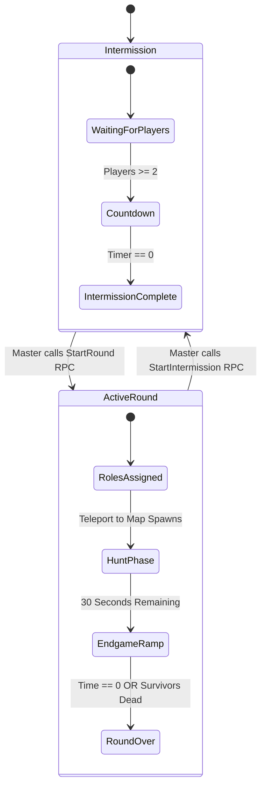
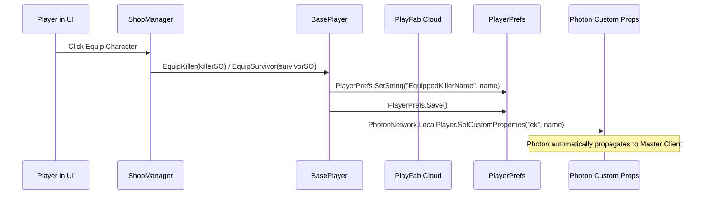

# Game Loop, Malice Mechanics & Economy Architecture

This document details the state machine governing match progression, the Malice killer selection algorithm, the Cube Coin (`CC`) reward distribution rules, and PlayFab store mechanics.

---

## 1. Match State Machine & Lifecycle

The match progression is centrally orchestrated by [RoundManager.cs](file:///g:/Projects/physicsgamee/Assets/Scripts/RoundManager.cs) and [ServerManager.cs](file:///g:/Projects/physicsgamee/Assets/Scripts/ServerManager.cs):



### State Breakdown

| State | Duration | Events Fired | Player Role / Visual State |
| :--- | :--- | :--- | :--- |
| **Intermission** | ~50s | `OnIntermissionStart` | Role = `None`. Players display their chosen cosmetic color (`localHex`) and accessories. Abilities disabled. Spawned at `intermissionSpawnPoint`. |
| **Active Round** | 180s (3m) | `OnRoundStart` | One player assigned `Killer`, others assigned `Survivor`. Character materials & stats applied. Abilities enabled. Spawns split across map. |
| **Endgame Ramp** | Last 30s | Handled by `EndgameManager` | Global Volume smoothly ramps Chromatic Aberration (`0.5`), Lens Distortion (`0.1`), Saturation (`+40`). Audio tick on final 10s. |

---

## 2. The Malice System & Killer Selection

The Killer is not chosen purely at random; CUBE uses an adaptive karma mechanic called **Malice** (`BasePlayerStats.malice`):

### How Malice Works

1. **Malice Accumulation**:
   - Every Survivor who survives a round gains **+1 Malice**.
   - As a player plays more rounds without being Killer, their Malice builds progressively.
2. **Killer Assignment Algorithm**:
   - At round start, the Master Client iterates through all connected players.
   - Finds the highest `malice` value among contenders.
   - If multiple players are tied with the highest Malice, one is chosen at random.
   - The selected player is assigned the **Killer** role; all other players are assigned **Survivor**.
3. **Malice Deduction**:
   - When the round ends, the player who served as Killer has their Malice reduced by **-5 Malice** (down to a minimum of 0 or negative floor).
   - This ensures fair role rotation across all players in the lobby.

---

## 3. Cube Coin (`CC`) Economy & Rewards ([CubeCoinRewardManager.cs](file:///g:/Projects/physicsgamee/Assets/Scripts/CubeCoinRewardManager.cs))

Cube Coins (`CC`) are the game's primary currency, stored securely in the cloud via PlayFab Virtual Currency.

### Reward Schedule

| Condition | Amount | Constraints / Abuse Caps |
| :--- | :--- | :--- |
| **Distance Traveled** | **5 CC** per 100 meters | Sampled every second; capped at 10,000 meters per round |
| **Ability Activation** | **15 CC** per activation | Capped at 20 rewarded activations per round (300 CC max) |
| **Survivor Elimination** | **25 CC** per kill | Killer-only reward |
| **Survivor Victory** | **15 CC** | Awarded if survivor is alive when round timer expires |
| **Killer Victory** | **30 CC** | Awarded if all survivors are eliminated |
| **Low-Health Clutch Win** | **10–50 CC** | Scaled inversely with remaining health below 20 HP |
| **Mid-Chase Ragequit Escape** | **40 CC** | Awarded to Killer if a Survivor disconnects while in chase |

> [!NOTE]
> All reward conditions are evaluated on the **local client** (`photonView.IsMine`), and then awarded directly to PlayFab via `PlayfabManager.Instance.AddCubeCoins(amount)`.

---

## 4. PlayFab Backend Integration ([PlayfabManager.cs](file:///g:/Projects/physicsgamee/Assets/Scripts/PlayfabManager.cs))

`PlayfabManager` operates as a persistent singleton (`DontDestroyOnLoad`) handling cloud synchronization:

### 1. Silent Device Authentication
- On startup, logs in via `PlayFabClientAPI.LoginWithCustomID`:
  ```csharp
  CustomId = SystemInfo.deviceUniqueIdentifier,
  CreateAccount = true
  ```
- Authenticates with Photon concurrently using `GetPhotonAuthenticationTokenRequest`.

### 2. Virtual Currency (`CC`) Sync
- Keeps an in-memory cache `CachedCC`.
- Fires `OnCubeCoinsChanged` event whenever balances change, immediately updating the HUD via [PlayerUIHandler.cs](file:///g:/Projects/physicsgamee/Assets/Scripts/PlayerUIHandler.cs).
- Adds coins via `PlayFabClientAPI.AddUserVirtualCurrency`.
- Deducts coins via `PlayFabClientAPI.SubtractUserVirtualCurrency` during store transactions.

### 3. Title Data & Announcements
- Fetches remote server announcements, Message of the Day (MOTD), and update banners directly from PlayFab Title Data.

---

## 5. Shop & Customization System ([ShopManager.cs](file:///g:/Projects/physicsgamee/Assets/Scripts/ShopManager.cs))

The in-game store provides an intuitive interface for browsing, purchasing, and equipping items:

### Shop Categories (Tabs)
1. **Shop Killers**: Browse unowned killer characters; purchase with CC.
2. **Shop Survivors**: Browse unowned survivor characters; purchase with CC.
3. **Shop Emotes**: Browse available animations (Dab, Sit, Yippie, etc.).
4. **Owned Killers / Survivors / Emotes**: View and equip unlocked assets.

### Equipping & Syncing Workflow

