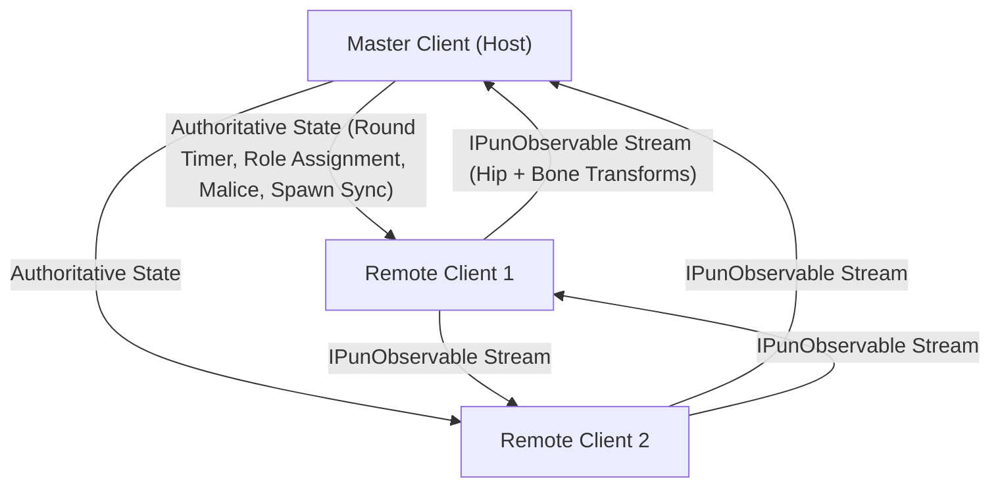

# Networking & Multiplayer Architecture (Photon PUN 2)

This document explains the multiplayer architecture of **CUBE**, focusing on network topology, authority boundaries, RPC buffering lifecycle, physical state synchronization, and room management.

---

## 1. Network Topology & Authority Model

CUBE operates on a **client-hosted, server-authoritative hybrid model** via Photon Unity Networking 2 (PUN 2):



### Authority Matrix

| Domain | Authority Holder | Mechanism |
| :--- | :--- | :--- |
| **Round State & Timing** | **Master Client** | [RoundManager.cs](file:///g:/Projects/physicsgamee/Assets/Scripts/RoundManager.cs) via buffered RPCs |
| **Killer Selection & Role Assignment** | **Master Client** | [ServerManager.cs](file:///g:/Projects/physicsgamee/Assets/Scripts/ServerManager.cs) via `ApplyRoleAndCharacter` RPC |
| **Malice Adjustments** | **Master Client** | Evaluates round outcomes, issues `AdjustMalice` RPCs |
| **Active Ragdoll Physics Simulation** | **Owning Client** (`photonView.IsMine`) | Fully dynamic Rigidbodies; simulated locally |
| **Ragdoll Replication to Others** | **Owning Client** | Streams transforms via [RagdollNetwork.cs](file:///g:/Projects/physicsgamee/Assets/Scripts/RagdollNetwork.cs) |
| **Remote Ragdoll Representation** | **Remote Clients** | Rigidbodies set to `isKinematic = true`, lerping snapshots |
| **Local Player Movement & Input** | **Owning Client** | Direct input reading (`CharacterInput`, `MovementSC`, `PlayerPuncher`) |
| **Damage & Hit Application** | **Victim Client** | Hits received via RPC; victim deducts health locally and fires feedback |
| **Currency & Inventory Grants** | **Owning Client** | Local player validates conditions and calls PlayFab API directly |

---

## 2. Remote Procedure Call (RPC) Lifecycle & Buffering

RPCs are invoked using `photonView.RPC("MethodName", RpcTarget.<Target>, ...args)`. Understanding target scopes is critical:

### RPC Targets in CUBE

1. **`RpcTarget.All`**:
   - Used for **transient events** that do not need to persist for late joiners:
     - `PlayerHitboxManager.RPC_OnHit(damage)`
     - `RoundManager.EndRound()`
     - Particle and audio triggers.

2. **`RpcTarget.AllBuffered`**:
   - Used for **persistent state** that incoming or late-joining players must receive immediately upon scene load:
     - `RoundManager.StartIntermission(spawnPos, spawnRot, endTime)`
     - `RoundManager.StartRound(roundEndTime)`
     - `PlayerCustomizer.ApplyRoleAndCharacter(playerType, characterId)`
     - `BasePlayerStats.ApplyCharacterStats(hp, speed, stamina)`
     - `BasePlayerStats.AdjustMalice(delta)`

> [!CAUTION]
> ### The Buffered RPC Stale State Trap
> When a round ends, old buffered RPCs (such as `ApplyRoleAndCharacter` or `StartRound`) will remain in Photon's buffer if not explicitly removed. If a player joins during Intermission, Photon will replay those old round RPCs, incorrectly forcing the player into an active round state!
>
> **The Solution in CUBE**:
> At every round and intermission transition, the Master Client explicitly purges buffered RPCs:
> ```csharp
> // Flush RoundManager view buffer
> PhotonNetwork.RemoveRPCs(photonView);
> 
> // Flush per-player role and stat buffers in ServerManager
> PhotonNetwork.RemoveBufferedRPCs(pv.ViewID, "ApplyRoleAndCharacter");
> PhotonNetwork.RemoveBufferedRPCs(pv.ViewID, "ApplyCharacterStats");
> PhotonNetwork.RemoveBufferedRPCs(pv.ViewID, "SetPlayerType");
> PhotonNetwork.RemoveBufferedRPCs(pv.ViewID, "ResetToDefaultStats");
> ```

---

## 3. Ragdoll Physical State Sync ([RagdollNetwork.cs](file:///g:/Projects/physicsgamee/Assets/Scripts/RagdollNetwork.cs))

Because active ragdolls consist of multiple interconnected rigidbodies and joints, syncing standard transforms produces jitter, desync, and flying limbs. CUBE uses a dedicated `IPunObservable` solution:

### On the Owning Client (`photonView.IsMine`):
- All rigidbodies in `RIG` are non-kinematic and driven by physics forces and motors.
- In `OnPhotonSerializeView(PhotonStream stream, PhotonMessageInfo info)`:
  - Writes root Hip position, rotation, and estimated velocity in world-space.
  - Writes 15 key bone local positions, local rotations, and local velocities.

### On Remote Clients (`!photonView.IsMine`):
- All rigidbodies in `RIG` are set to `isKinematic = true` to prevent fighting the network state.
- SkinnedMeshRenderers have `updateWhenOffscreen = true` enabled.
- Snapshots are stored in an adaptive circular buffer (`MAX_BUFFER = 32`).
- **Adaptive Jitter Interpolation**:
  - Automatically measures packet arrival intervals and updates `adaptedBackTime`.
  - Performs **Hermite spline interpolation** for positions and **spherical linear interpolation (Slerp)** for rotations.
  - If a positional discrepancy exceeds `teleportThreshold` (3 units), it performs a fast blend rather than an abrupt snap to prevent visual popping.

---

## 4. Player Custom Properties

Photon Player Custom Properties (`PhotonNetwork.LocalPlayer.SetCustomProperties`) synchronize lightweight, persistent metadata without polluting the RPC stream:

| Property Key | Constant | Type | Description |
| :--- | :--- | :--- | :--- |
| `"ek"` | `BasePlayer.PropEquippedKiller` | `string` | Name of the killer equipped by the player (e.g., `"The Glitch"`). |
| `"es"` | `BasePlayer.PropEquippedSurvivor` | `string` | Name of the survivor equipped by the player (e.g., `"The Coder"`). |

When the Master Client starts a round in `ServerManager.HandleRoundStart()`, it reads these custom properties directly from each client's `Photon.Realtime.Player` object to assign the correct character skin and stats.

---

## 5. Matchmaking & Room Connection Flow

Managed by [PhotonMenuConnector.cs](file:///g:/Projects/physicsgamee/Assets/Scripts/PhotonMenuConnector.cs):

1. **Authentication Handshake**:
   - Client authenticates with PlayFab first (`PlayfabManager`).
   - PlayFab issues a Photon ticket via `GetPhotonAuthenticationTokenRequest`.
   - Ticket is passed to `PhotonNetwork.AuthValues`.
   - `PhotonNetwork.ConnectUsingSettings()` is called.

2. **Room Creation & Join Types**:
   - **Public Match**: Joins a random open room via `PhotonNetwork.JoinRandomRoom()`. If none exists, creates a visible, open room.
   - **Private Host**: Generates a 5-character alphanumeric room code (omitting confusing characters `I, O, 0, 1`). Room is created with `IsVisible = false`.
   - **Private Join**: Player inputs room code into UI; joins via `PhotonNetwork.JoinRoom(roomCode)`.

3. **Scene Synchronization**:
   - `PhotonNetwork.AutomaticallySyncScene = true` is enforced.
   - When the Master Client calls `PhotonNetwork.LoadLevel("SampleScene")`, all connected clients automatically load the arena scene simultaneously.

---

## 6. Late Joiner State Synchronization

When a player joins a match while a round is already in progress:
1. `RoundManager.OnPlayerEnteredRoom(newPlayer)` fires on the Master Client.
2. Master client collects current actor numbers, role assignments, and player colors.
3. Sends targeted RPC `SyncState` directly to the `newPlayer` target (not buffered).
4. Late joiners are placed into Intermission / Spectator state at `SyncedIntermissionSpawnPos` rather than being spawned inside the live map arena.
