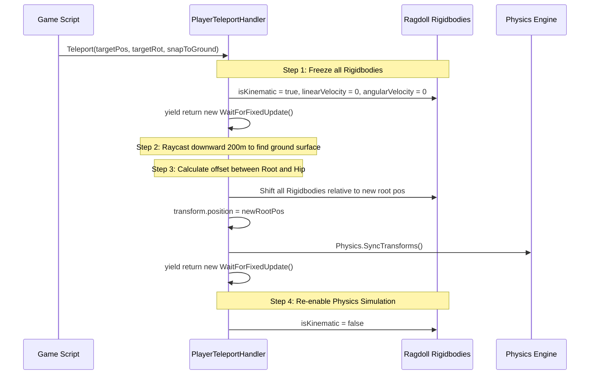
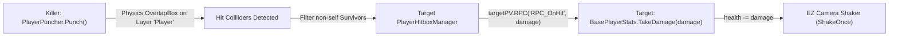

# Player Physics, Locomotion & Combat Systems

This document explains the active ragdoll physics implementation, character movement controllers, the required teleportation pipeline, melee combat, damage handling, death flow, and spectating.

---

## 1. Dual-Hierarchy Active Ragdoll Architecture

CUBE characters are **active ragdolls** (built on `Assets/Plugins/PhysicsChar`). Unlike standard Unity character controllers or static animated humanoids, characters are physics-driven bodies governed by joint motors, balancing scripts, and procedural forces.

```
BaseCharacter (Root GameObject)
 ├── Rigidbody (isKinematic = true, useGravity = false)
 ├── BasePlayer & BasePlayerStats
 └── RIG (Active Physics Hierarchy)
      ├── Hip (Root ragdoll bone with primary active Rigidbody)
      ├── Spine, Chest, Head (Connected via ConfigurableJoints)
      ├── Limbs (Legs & Arms driven by joint angular drives)
      ├── StandingSC (Applies upward & balance torque to keep character upright)
      ├── FootBalance_MM (Maintains grounded footing)
      ├── MovementSC (Applies directional walk forces)
      └── SprintingSC (Increases force while draining stamina)
```

### Key Physics Components

| Component | Location | Role |
| :--- | :--- | :--- |
| **`StandingSC`** | `RIG` | Contains `rigToLift` array. Applies vertical spring forces and orientation torques to keep the ragdoll standing. When ragdolled/dead, multipliers are zeroed. |
| **`Rig`** | `RIG` | Master muscle strength controller (`rig.control = 1` for standing, `0` for limp ragdoll). |
| **`MovementSC`** | `RIG` | Reads movement direction and applies physics forces (`Force = speed`) directly to the hip and leg rigidbodies. |
| **`SprintingSC`** | `RIG` | When sprint key is held and stamina > 0, multiplies walk force and drains stamina over time. |
| **`CameraInput`** | `CameraHead` | Reads mouse and gamepad look inputs to rotate the camera and yaw the character orientation. |

---

## 2. The Teleportation Pipeline ([PlayerTeleportHandler.cs](file:///g:/Projects/physicsgamee/Assets/Scripts/PlayerTeleportHandler.cs))

> [!CAUTION]
> ### Why You Must NEVER Directly Change `transform.position`
> Setting `transform.position` or `transform.rotation` directly on the player root or on ragdoll bones causes catastrophic physics explosions:
> - Connected `ConfigurableJoint`s detect massive instantaneous position deltas.
> - Joint motors exert extreme counter-forces, causing limbs to stretch, launch across the map, or clip through geometry.
> - The root container and the physical hip desynchronize permanently.

### Safe Teleportation Sequence

All player relocations (spawning, map teleports, intermission returns) **must** go through `PlayerTeleportHandler.Teleport(...)`:



---

## 3. Combat, Melee & Hit Detection

Combat is asymmetric: Killers hunt and eliminate Survivors using punches and active abilities.



### 1. Melee Hit Detection ([PlayerPuncher.cs](file:///g:/Projects/physicsgamee/Assets/Scripts/PlayerPuncher.cs))
- **Trigger**: Armed via `PoseHandler.onArmHandle` (swing animation/input).
- **Hitbox Calculation**:
  - Center: `cam.position + cam.forward * (size.z / 2f + 0.6f)`
  - Size: Loaded from the equipped character's ScriptableObject (`killerType.punchHitboxSize`).
  - Layer Mask: Evaluated strictly against the `Player` layer (`LayerMask.GetMask("Player")`).
- **Target Filtering**:
  - Rejects self-hits (`targetPV.IsMine == false`).
  - Rejects hits against other Killers (only Survivors can take damage).
  - Maintains `hitThisSwing` (`HashSet<PhotonView>`) to guarantee each player is hit at most once per swing.

### 2. Secondary Bone Collisions ([PlayerHitboxManager.cs](file:///g:/Projects/physicsgamee/Assets/Scripts/PlayerHitboxManager.cs))
- Ragdoll bone colliders carry [CollisionCallback.cs](file:///g:/Projects/physicsgamee/Assets/Scripts/CollisionCallback.cs).
- When a Killer's fists or active weapons physically collide with a Survivor's bone collider, `CollisionEntered` fires and validates the hit.

### 3. Damage Execution ([BasePlayerStats.cs](file:///g:/Projects/physicsgamee/Assets/Scripts/BasePlayerStats.cs))
- Damage is applied via RPC:
  ```csharp
  targetView.RPC(nameof(PlayerHitboxManager.RPC_OnHit), RpcTarget.All, damage);
  ```
- Target executes `TakeDamage(damage)`:
  - Deducts health: `health = Mathf.Max(0, health - actualDamage)`.
  - Triggers local feedback: `CameraShaker.Instance.ShakeOnce(1.4f, 4f, 0f, 0.7f)`.
  - Invokes `OnDamageTaken` event (updates HUD red damage vignette in `PlayerUIHandler`).

---

## 4. Death & Ragdoll Collapse ([DeathSC.cs](file:///g:/Projects/physicsgamee/Assets/Scripts/DeathSC.cs))

When `BasePlayerStats.health <= 0`:

1. **Physical Collapse**:
   - `died = true`.
   - Standing forces collapsed: `rig.multiplier = 0` for all elements in `standing.rigToLift`.
   - Master muscle control disabled: `rig.control = 0`. Character completely collapses into an unpowered ragdoll.
2. **Script Disablement**:
   - Disables all player locomotion scripts (`MovementSC`, `JumpingSC`, `CharacterInput`, `PlayerPuncher`).
3. **Respawn & Spectator Logic**:
   - Starts 5-second `Respawn` coroutine.
   - **If Active Round**: The player does not return to the game immediately. [SpectatorController.cs](file:///g:/Projects/physicsgamee/Assets/Scripts/SpectatorController.cs) activates.
   - **If Intermission**: Teleports back to the lobby spawn via `PlayerTeleportHandler.Teleport(...)`.

---

## 5. Spectator Mode ([SpectatorController.cs](file:///g:/Projects/physicsgamee/Assets/Scripts/SpectatorController.cs))

When eliminated mid-round, local players seamlessly transition to spectator mode:
- **Target Collection**: Automatically discovers all living `BasePlayer` instances where `stats.health > 0`.
- **Camera Orbit**:
  - Positions `Camera.main` at an offset orbit around the target's hip bone (`orbitDistance = 5f`, `orbitHeightOffset = 1.5f`).
  - Supports mouse drag and gamepad right-stick orbit rotation.
- **Target Cycling**:
  - Left Click / Right Click or Controller Bumpers cycle forward/backward through surviving players.
  - UI updates dynamically via `Canvas/Spectate` showing `Spectating: <PlayerName>`.
- **Exit Condition**: Automatically tears down when `RoundManager.OnIntermissionStart` fires.
